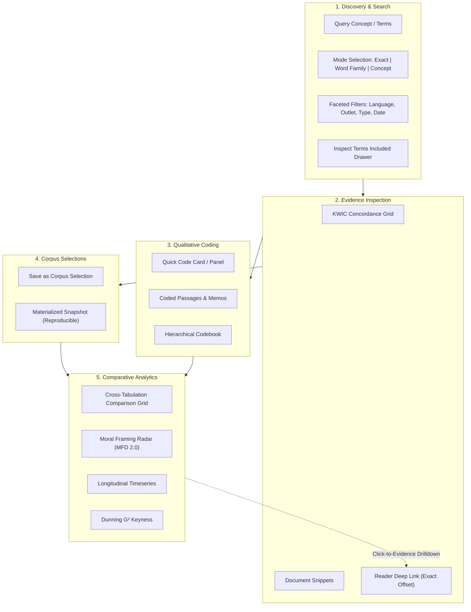

# DIDI Beta Documentation & Architecture

## 1. Beta Definition & Product Objective
The **DIDI Platform** (Digital Discourse / Media Framing Analysis Workbench) is an academic mixed-methods research environment developed for Eurac Research and the University of Innsbruck.

The beta release integrates qualitative close reading with quantitative multilingual text analysis into a single auditable coordinate system:

$$\text{Document} \longrightarrow \text{Provenance} \longrightarrow \text{Offsets} \longrightarrow \text{Tokens} \longrightarrow \text{Codes/Memos} \longrightarrow \text{Measures} \longrightarrow \text{Selections} \longrightarrow \text{Evidence}$$

### Included Beta Milestones
- **Milestone 0:** Baseline protection, beta tracking, and integration fixtures.
- **Milestone 1:** Search correctness, apostrophe escaping, explicit search modes (`exact`, `word_family`, `concept`), date controls, and expansion transparency.
- **Milestone 2:** KWIC (Key Word In Context) concordance grid, reader deep linking at character offsets, search-to-code workflow, and search distributions.
- **Milestone 3:** Saved corpus selections (dynamic definitions + materialized snapshots) as first-class objects.
- **Milestone 4:** Qualitative workbench completion (memos, document variables, code co-occurrence, visual codeline, intercoder agreement, and QDPX import/export round-trip).
- **Milestone 5:** Generalized comparison engine (comparing arbitrary saved selections with denominators, small-sample warnings, and evidence drill-down).
- **Milestone 6:** Linked exploratory workspace (cross-filtered coordination across time, outlet, collocates, dispersion, and keyness).
- **Milestone 7:** Reproducibility registry, corpus versioning, exportable analysis recipes, and beta hardening.

### Explicitly Excluded Features (Post-Beta)
- External generative AI / LLM second-coders (copyrighted data remains local and sovereign).
- CQP / Corpus Workbench query languages.
- Unconstrained BERTopic or topic model auto-tagging.
- Actor-claim network graphs.
- Causal inference (Interrupted Time Series / DiD) without verified counterfactual designs.
- Multimodal image framing.

---

## 2. Beta Workflow Diagram

---

## 3. Implementation Status Tracker

| Milestone | Scope | Status | Verification / Evidence |
| :--- | :--- | :---: | :--- |
| **M0** | Baseline protection, tracking, fixtures, benchmarks | **COMPLETED** | `tests/test_beta_fixtures.py`, `docs/beta/` |
| **M1** | Search correctness, apostrophes, modes, dates, latency (<0.2s) | **COMPLETED** | `tests/test_search_modes.py`, `tests/test_api.py` |
| **M2** | KWIC concordance, exact coordinate alignment, deep linking, search-to-code | **COMPLETED** | `tests/test_concordance.py`, `SearchPage.tsx`, `ArticleReader.tsx` |
| **M3** | Saved corpus selections (PostgreSQL schema, CRUD, snapshots, refresh) | **COMPLETED** | `tests/test_selections.py`, `0003_saved_corpus_selections.py` |
| **M4** | Qualitative workbench: Inter-coder agreement (Cohen's Kappa, confusion matrix) | **COMPLETED** | `tests/test_agreement.py`, `AnalysisTab.tsx` |
| **M5** | Generalized comparison engine (subcorpora, baseline, partitions, radar, G²) | **COMPLETED** | `tests/test_selections.py:test_compare_selections`, `AnalysisTab.tsx` |
| **M6** | Linked exploratory workspace (Word Bubble, KWIC navigation, Lexical Dossier) | **COMPLETED** | `WordBubble.test.tsx`, `LexicalDossierModal.tsx` |
| **M7** | Reproducibility registry, JSON/Markdown manifests, APA bibliography, end-to-end audit | **COMPLETED** | `tests/test_beta_workflow.py`, `/exports/manifest.{json,md}` |

